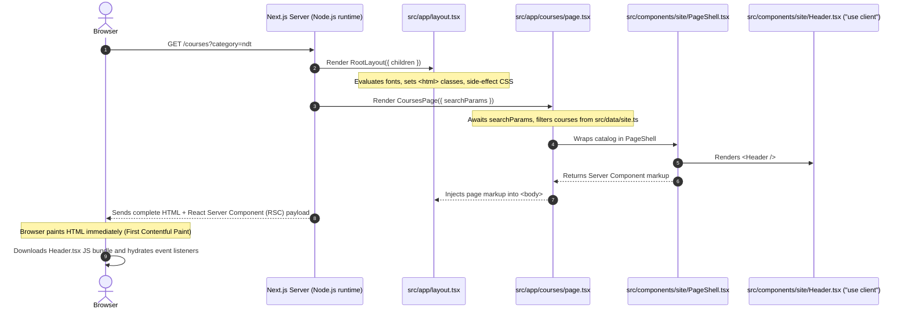

# Altair Academy — Next.js App Router Architecture & Technical Guide

Welcome to the Altair Academy codebase. This project has been migrated from **TanStack Start** (Vite, Nitro, TanStack Router) to **Next.js 15 (App Router, React 19, TypeScript, Tailwind CSS v4)**.

This document is a comprehensive, plain-language architectural explanation designed for engineers who know React and the original TanStack Start codebase but are new to Next.js. Every section ties directly to real code and files in this repository.

---

## Table of Contents

1. [The Big Picture: How a Request Becomes a Page](#1-the-big-picture-how-a-request-becomes-a-page)
2. [Server Components vs. Client Components](#2-server-components-vs-client-components)
3. [Routing, Layouts, and Navigation](#3-routing-layouts-and-navigation)
4. [Metadata and SEO](#4-metadata-and-seo)
5. [Data Flow and Static Assets](#5-data-flow-and-static-assets)
6. [Styling, Typography, and Images](#6-styling-typography-and-images)
7. [Deep Dive: The Interactive Pages (/calendar & /careers)](#7-deep-dive-the-interactive-pages-calendar--careers)
8. [TanStack Start vs. Next.js App Router Rosetta Stone](#8-tanstack-start-vs-nextjs-app-router-rosetta-stone)
9. [Day-to-Day Developer Cookbook](#9-day-to-day-developer-cookbook)
10. [Codebase Gotchas & Honest Technical Review](#10-codebase-gotchas--honest-technical-review)
11. [Self-Check Quiz (10 Questions & Answers)](#11-self-check-quiz)

---

## 1. The Big Picture: How a Request Becomes a Page

### What This Application Is

Altair Academy is an accredited technical training organisation website (specialising in Non-Destructive Testing [NDT], Corrosion, BIM, and Management Systems). It is a public marketing and educational catalog website consisting of:

- Informational pages (`/`, `/about`, `/contact`, `/instructors`, `/news`, `/privacy`, `/terms`)
- A searchable and filterable course catalog (`/courses`, `/courses/[slug]`, `/search`)
- An interactive training calendar (`/calendar`)
- An employment enquiry page (`/careers`)
- Management team profiles (`/team/[slug]`)

### Lifecycle of an HTTP Request

In TanStack Start with Vite, client code was bundled into a single-page app (SPA) with server-side pre-rendering handled by Nitro. In **Next.js App Router**, the server evaluates React components on the fly or pulls pre-rendered HTML from the build cache, and only ships JavaScript for components that explicitly declare they need client interactivity.

Here is the exact step-by-step path taken when a user visits **`https://altair.academy/courses?category=ndt`**:



#### File-by-File Trace for `/courses?category=ndt`:

1. **[src/app/layout.tsx](file:///d:/Altair.Academy/altair-academy-website-main/src/app/layout.tsx)**:
   - Next.js invokes `RootLayout`.
   - Google fonts (`Archivo` and `Barlow`) are assigned CSS variable class names (`--font-archivo`, `--font-barlow`) on `<html>`.
   - `../styles.css` is applied.
2. **[src/app/courses/page.tsx](file:///d:/Altair.Academy/altair-academy-website-main/src/app/courses/page.tsx)**:
   - The page receives `searchParams` as a Promise (`Promise<{ [key: string]: string | string[] | undefined }>`).
   - Line 27: `const resolvedParams = await searchParams;` unwraps the query.
   - Line 28-30: Reads `resolvedParams["category"]`, extracts `"ndt"`, and filters the courses array:
     ```tsx
     const rawCategory = resolvedParams["category"];
     const category = typeof rawCategory === "string" ? rawCategory : undefined;
     const filtered = category ? courses.filter((c) => c.categorySlug === category) : courses;
     ```
3. **[src/components/site/PageShell.tsx](file:///d:/Altair.Academy/altair-academy-website-main/src/components/site/PageShell.tsx)**:
   - Renders the outer shell, including `<Header />`, `<SectionHeader />`, and `<Footer />`.
4. **[src/components/site/Header.tsx](file:///d:/Altair.Academy/altair-academy-website-main/src/components/site/Header.tsx)**:
   - Even though `Header` is marked `"use client"`, Next.js renders its initial HTML on the server.
   - `NavLink` checks `usePathname()` (which is `"/courses"`), sets `data-status="active"` on the "Our Courses" link, and outputs the desktop and mobile navigation.
5. **[src/components/site/CourseCard.tsx](file:///d:/Altair.Academy/altair-academy-website-main/src/components/site/CourseCard.tsx)**:
   - Renders each matching course card (e.g. Visual Testing VT, Weld Inspection WI) with optimized `next/image` tags and `next/link` anchors.
6. **Browser Hydration**:
   - The browser receives fully formed HTML and displays the page immediately.
   - The browser downloads only the small JavaScript bundle required for `Header.tsx` (and any other client components), attaching event listeners for dropdowns, search input, and mobile hamburger clicks. The course list itself has zero client-side JavaScript.

---

### Static vs. Dynamic Rendering in This Project

In Next.js App Router, every page is rendered in one of three ways:

| Rendering Type                   | Symbol in Build Output | Explanation                                                                                                                                        | Routes in This Project                                                                                           |
| :------------------------------- | :--------------------: | :------------------------------------------------------------------------------------------------------------------------------------------------- | :--------------------------------------------------------------------------------------------------------------- |
| **Static (Prerendered)**         |          `○`           | Generated as pure HTML files at build time (`npm run build`). Never re-calculated at request time. Ultra fast, CDN-cacheable.                      | `/`, `/about`, `/calendar`, `/careers`, `/contact`, `/instructors`, `/news`, `/privacy`, `/terms`, `/_not-found` |
| **Static Site Generation (SSG)** |          `●`           | Static pages with dynamic route segments whose parameters are known ahead of time via `generateStaticParams()`. Prerendered at build time.         | `/courses/[slug]`<br/>`/team/[slug]`                                                                             |
| **Dynamic (Server-Rendered)**    |          `ƒ`           | Rendered on the server on every request. Triggered whenever a page accesses dynamic request values like URL search parameters or incoming headers. | `/courses` (reads `searchParams.category`)<br/>`/search` (reads `searchParams.q`)                                |

#### How `generateStaticParams` Works in Detail

In [src/app/courses/[slug]/page.tsx](file:///d:/Altair.Academy/altair-academy-website-main/src/app/courses/[slug]/page.tsx):

```tsx
export function generateStaticParams() {
  return courses.map((course) => ({
    slug: course.slug,
  }));
}
```

During `npm run build`, Next.js executes `generateStaticParams()`. It loops through the 4 courses in `src/data/site.ts` and prerenders individual static HTML files:

- `/courses/visual-testing-vt.html`
- `/courses/weld-inspection-wi.html`
- `/courses/iso-50001-energy-management.html`
- `/courses/infrastructure-asset-assessment-bim.html`

The same happens for [src/app/team/[slug]/page.tsx](file:///d:/Altair.Academy/altair-academy-website-main/src/app/team/[slug]/page.tsx) for all team members.

---

## 2. Server Components vs. Client Components

This is the single most important architectural concept in Next.js App Router.

### The Rule and the Reason

- **Default (Server Components)**: By default, every component in `src/app/` and `src/components/` is a **Server Component**. It executes **only on the server** during the build or when handling a request. It never ships its code to the user's browser. It cannot use React hooks (`useState`, `useEffect`, `useRef`), browser APIs (`window`, `localStorage`), or event handlers (`onClick`, `onChange`).
- **`"use client"` (Client Components)**: When a file has `"use client"` at line 1, it defines a **client boundary**. Next.js compiles that file and its imports into browser JavaScript bundles. Client components can use hooks, browser APIs, and user event handlers.

> **Key Takeaway**: `"use client"` does not mean "render only in browser". Client components are still pre-rendered into static HTML on the server during SSR; the directive simply tells Next.js to also package and send their JavaScript to the browser so they can become interactive (hydrate).

### Complete Directory of Client Components (`"use client"`) in This Project

Every single file in this codebase with `"use client"` is listed below with the exact reason it requires client capabilities:

#### 1. Page-Level Error Boundaries

- **[src/app/error.tsx](file:///d:/Altair.Academy/altair-academy-website-main/src/app/error.tsx)**: Next.js requires error boundaries to be Client Components. Uses `useRouter()`, `useEffect()` to log and report errors to Lovable, and `onClick` on the "Try again" button.
- **[src/app/global-error.tsx](file:///d:/Altair.Academy/altair-academy-website-main/src/app/global-error.tsx)**: Root layout fallback error boundary. Needs `onClick` to call `reset()`.

#### 2. Site Interactive Features

- **[src/components/site/Header.tsx](file:///d:/Altair.Academy/altair-academy-website-main/src/components/site/Header.tsx)**:
  - `useState` for mobile navigation drawer (`mobileOpen`), courses dropdown flyout (`coursesOpen`), search field visibility (`searchOpen`), and search query (`query`).
  - `useRef` and `useEffect` for clicking outside the dropdown or pressing `Escape` to close it.
  - `useRouter` and `usePathname` for programmatic search redirection and active link highlighting (`data-status="active"`).
- **[src/components/site/CalendarContent.tsx](file:///d:/Altair.Academy/altair-academy-website-main/src/components/site/CalendarContent.tsx)**:
  - `useState` for calendar views (`"day" | "month" | "year"`), active month index, and selected date.
  - `useMemo` for filtering sessions and calculating monthly calendar grid cells.
  - `useEffect` for client-side date synchronization (hydration fix).
  - `onClick` handlers for month arrows, view toggles, and date cell selection.
- **[src/components/site/CareersContent.tsx](file:///d:/Altair.Academy/altair-academy-website-main/src/components/site/CareersContent.tsx)**:
  - `useState` for uploaded file name display (`fileName`) and form submission status (`submitted`).
  - `onChange` for the file input and `onSubmit` for the resume submission form.

#### 3. UI Library Components ([src/components/ui](file:///d:/Altair.Academy/altair-academy-website-main/src/components/ui))

All 35 UI components below wrap Radix UI, Embla Carousel, Cmdk, or Vaul. These libraries rely on browser DOM events, keyboard accessibility handlers, portals, and React Context:

- `accordion.tsx`, `alert-dialog.tsx`, `aspect-ratio.tsx`, `avatar.tsx`, `calendar.tsx`, `carousel.tsx`, `chart.tsx`, `checkbox.tsx`, `collapsible.tsx`, `command.tsx`, `context-menu.tsx`, `dialog.tsx`, `drawer.tsx`, `dropdown-menu.tsx`, `form.tsx`, `hover-card.tsx`, `input-otp.tsx`, `label.tsx`, `menubar.tsx`, `navigation-menu.tsx`, `popover.tsx`, `progress.tsx`, `radio-group.tsx`, `resizable.tsx`, `scroll-area.tsx`, `select.tsx`, `sheet.tsx`, `sidebar.tsx`, `slider.tsx`, `sonner.tsx`, `switch.tsx`, `tabs.tsx`, `toggle-group.tsx`, `toggle.tsx`, `tooltip.tsx`.

---

### Important Server Components and What They Gain

The following high-impact files are pure Server Components:

- **[src/app/page.tsx](file:///d:/Altair.Academy/altair-academy-website-main/src/app/page.tsx) (Home Page)**: 23 KB of JSX including the hero banner, course grids, stats, approach, and FAQs. Because it is a Server Component, **none** of that JSX or data logic is parsed as JavaScript in the browser. It renders straight to static HTML.
- **[src/components/site/Testimonials.tsx](file:///d:/Altair.Academy/altair-academy-website-main/src/components/site/Testimonials.tsx)**: Despite having a rotating "fan" visual effect, it uses pure CSS animations (`animationDelay`, `.testimonial-card`). It uses no hooks, so it is a Server Component, adding 0 KB of client JavaScript.
- **[src/components/site/CourseCard.tsx](file:///d:/Altair.Academy/altair-academy-website-main/src/components/site/CourseCard.tsx)** & **[TeamCard.tsx](file:///d:/Altair.Academy/altair-academy-website-main/src/components/site/TeamCard.tsx)**: Pure presentational cards.
- **[src/components/site/Footer.tsx](file:///d:/Altair.Academy/altair-academy-website-main/src/components/site/Footer.tsx)**: Static links, contact information, and logo.

### Crossing the Server/Client Boundary

When a Server Component renders a Client Component, it can pass data via props. However, there are strict rules about what can cross this boundary:

```tsx
// src/app/calendar/page.tsx (Server Component)
export default function CalendarPage() {
  // Can pass primitives, arrays, plain objects, or children
  return <CalendarContent />;
}
```

```
✅ CAN cross the boundary:
- Strings, numbers, booleans, null, undefined
- Plain objects and Arrays
- JSX children (e.g. <ClientComponent><ServerComponent /></ClientComponent>)
- StaticImageData objects (imported images)

❌ CANNOT cross the boundary:
- Functions (e.g. onClick callbacks passed from server to client)
- Class instances (e.g. custom SDK classes, database connections)
- Symbols
```

---

## 3. Routing, Layouts, and Navigation

### File-System Routing in `src/app`

In Next.js App Router, the filesystem _is_ the router. Every folder inside `src/app/` represents a URL path segment, and only files named `page.tsx` become publicly accessible web pages:

```
src/app/
├── layout.tsx              -> Root layout (wraps every page)
├── page.tsx                -> URL: /
├── about/page.tsx          -> URL: /about
├── calendar/page.tsx       -> URL: /calendar
├── careers/page.tsx        -> URL: /careers
├── contact/page.tsx        -> URL: /contact
├── courses/
│   ├── page.tsx            -> URL: /courses (and /courses?category=...)
│   └── [slug]/page.tsx     -> URL: /courses/visual-testing-vt, etc.
├── instructors/page.tsx    -> URL: /instructors
├── news/page.tsx           -> URL: /news
├── privacy/page.tsx        -> URL: /privacy
├── search/page.tsx         -> URL: /search (and /search?q=...)
├── team/
│   └── [slug]/page.tsx     -> URL: /team/shaik-khaja-mohiuddin, etc.
└── terms/page.tsx          -> URL: /terms
```

### The Role of `layout.tsx`

[src/app/layout.tsx](file:///d:/Altair.Academy/altair-academy-website-main/src/app/layout.tsx) wraps the entire application. It defines the outer `<html>` and `<body>` tags. Unlike TanStack Router, where layout files often wrapped headers and footers around everything, in this project `<Header />` and `<Footer />` are rendered individually inside page components or [PageShell.tsx](file:///d:/Altair.Academy/altair-academy-website-main/src/components/site/PageShell.tsx). This ensures that 404 (`not-found.tsx`) and error screens remain clean and header-less.

### How `notFound()` Triggers `not-found.tsx`

In dynamic routes like [src/app/courses/[slug]/page.tsx](file:///d:/Altair.Academy/altair-academy-website-main/src/app/courses/[slug]/page.tsx):

```tsx
const course = courses.find((c) => c.slug === slug);
if (!course) notFound();
```

Calling `notFound()` from `next/navigation` halts rendering and immediately renders [src/app/not-found.tsx](file:///d:/Altair.Academy/altair-academy-website-main/src/app/not-found.tsx) with an HTTP 404 status code.

### Navigation and Active Link Highlighting

In TanStack Router, links used `data-[status=active]`. To keep all existing CSS classes intact without rewriting styling rules, we created a custom `NavLink` helper inside [src/components/site/Header.tsx](file:///d:/Altair.Academy/altair-academy-website-main/src/components/site/Header.tsx):

```tsx
function NavLink({
  href,
  exact = false,
  className,
  children,
  ...props
}: ComponentProps<typeof Link> & { exact?: boolean }) {
  const pathname = usePathname();
  const hrefString = typeof href === "string" ? href : (href.pathname ?? "");
  const active = exact
    ? pathname === hrefString
    : pathname === hrefString || pathname.startsWith(hrefString + "/");

  return (
    <Link
      href={href}
      className={className}
      data-status={active ? "active" : undefined}
      aria-current={active ? "page" : undefined}
      {...props}
    >
      {children}
    </Link>
  );
}
```

- For `"/"` (Home), `exact = true` ensures it only highlights when you are on the homepage.
- For `"/courses"`, non-exact matching means `pathname.startsWith("/courses/")` evaluates to `true`. Thus, when a user views `/courses/visual-testing-vt`, the **Our Courses** link in the header stays active!

---

## 4. Metadata and SEO

Next.js App Router provides built-in search engine optimization via the `Metadata` API.

### Static Metadata

Used on fixed pages like [src/app/about/page.tsx](file:///d:/Altair.Academy/altair-academy-website-main/src/app/about/page.tsx):

```tsx
export const metadata: Metadata = {
  title: "About Altair Academy — Global Leaders of Tomorrow",
  description: "Altair Academy is a BINDT-approved training organisation...",
  openGraph: {
    title: "About Altair Academy — Global Leaders of Tomorrow",
    description: "BINDT-approved technical training centre in Malaysia...",
    type: "website",
  },
  twitter: {
    card: "summary_large_image",
  },
};
```

### Dynamic Metadata (`generateMetadata`)

Used on dynamic pages like [src/app/courses/[slug]/page.tsx](file:///d:/Altair.Academy/altair-academy-website-main/src/app/courses/[slug]/page.tsx):

```tsx
export async function generateMetadata({ params }: Props): Promise<Metadata> {
  const { slug } = await params;
  const course = courses.find((c) => c.slug === slug);
  if (!course) {
    return {
      title: "Course unavailable — Altair Academy",
      robots: { index: false, follow: false },
    };
  }
  return {
    title: `${course.title} — Altair Academy`,
    description: course.summary,
    openGraph: {
      title: `${course.title} — Altair Academy`,
      description: course.summary,
      type: "website",
    },
    twitter: {
      card: "summary_large_image",
    },
  };
}
```

### Critical Next.js Metadata Behavior: Shallow Overwrite

> **Crucial Rule**: In Next.js, if a page exports an `openGraph` object, it **completely replaces** the layout's `openGraph` object (it does NOT deeply merge). In TanStack Start, meta tags were merged tag by tag. Therefore, in this codebase, every page explicitly includes `type: "website"` inside `openGraph` and `card: "summary_large_image"` inside `twitter`. If omitted, shared Facebook or Twitter link previews would lose their card formatting.

### Search Indexing Control (`robots`)

- **[src/app/search/page.tsx](file:///d:/Altair.Academy/altair-academy-website-main/src/app/search/page.tsx)** sets `robots: { index: false, follow: false }` to prevent search engines from indexing infinite query result variations.
- Dynamic 404 states in `generateMetadata` also set `robots: { index: false, follow: false }` so missing course/team URLs are never indexed.

---

## 5. Data Flow and Static Assets

### The Data Layer Structure

All data in this project is stored in statically typed TypeScript files inside `src/data/`:

```
src/data/
├── site.ts      -> Main data store (courses, categories, team, instructors, testimonials, faqs)
├── menu.ts      -> Navigation menu items (separated to keep Header bundle small)
├── contact.ts   -> Official contact details (phone, email, WhatsApp, address)
└── calendar.ts  -> 2026 NDT calendar slots, dates, and course code mappings
```

#### Why `menu.ts` and `contact.ts` Were Extracted

In TanStack Start, everything was in `site.ts`. However, `site.ts` imports dozens of high-resolution images for courses and instructors. In Next.js, [Header.tsx](file:///d:/Altair.Academy/altair-academy-website-main/src/components/site/Header.tsx) is a Client Component. If `Header.tsx` imported directly from `site.ts`, webpack/Turbopack would pull the entire course image dictionary into the browser's JavaScript bundle. By extracting `menu.ts` and `contact.ts` (and re-exporting them from `site.ts` for backwards compatibility), `Header.tsx` stays lean and fast.

### Tracing a Course from Data to Screen

Let's trace how the **Visual Testing (VT)** course is defined and rendered:

1. **Definition** in [src/data/site.ts](file:///d:/Altair.Academy/altair-academy-website-main/src/data/site.ts):
   ```tsx
   import courseNdt from "@/assets/course-ndt.jpg";

   export const courses: Course[] = [
     {
       slug: "visual-testing-vt",
       title: "Visual Testing (VT)",
       categorySlug: "ndt",
       summary: "Learn surface inspection fundamentals...",
       duration: "40 hours · 5 days",
       level: "Level I & II",
       price: "MYR 2,800",
       image: courseNdt, // Typed as StaticImageData
     },
     // ...
   ];
   ```
2. **Page Resolution** in [src/app/courses/[slug]/page.tsx](file:///d:/Altair.Academy/altair-academy-website-main/src/app/courses/[slug]/page.tsx):
   - At build time, `generateStaticParams()` queries `courses` and registers the slug `"visual-testing-vt"`.
   - `CourseDetailPage` looks up the slug in the array.
   - It passes `course.image` to `<Image src={course.image} alt={course.title} width={1200} height={800} />`.
   - It outputs the duration, price, and category badge.

### What is `StaticImageData`?

In Vite, `import img from "./hero.jpg"` returned a plain URL string (e.g. `"/assets/hero-a9f2.jpg"`).

In Next.js, static image imports return an object of type `StaticImageData`:

```ts
interface StaticImageData {
  src: string;
  height: number;
  width: number;
  blurDataURL?: string;
  blurWidth?: number;
  blurHeight?: number;
}
```

Because Next.js analyzes image dimensions at build time, it knows the exact aspect ratio before the image loads. This completely prevents **Cumulative Layout Shift (CLS)**, where a page jumps around while images download.

---

## 6. Styling, Typography, and Images

### Tailwind CSS v4 Architecture

This project uses **Tailwind CSS v4** via `@tailwindcss/postcss`. Notice that there is no `tailwind.config.js`; in Tailwind v4, configuration lives directly in CSS.

Look at [src/styles.css](file:///d:/Altair.Academy/altair-academy-website-main/src/styles.css):

1. **Source Directives**:
   ```css
   @import "tailwindcss" source(none);
   @source "../src";
   @import "tw-animate-css";
   ```
2. **Design Tokens (`@theme inline`)**:
   Maps CSS custom properties to Tailwind classes:
   ```css
   @theme inline {
     --font-sans: var(--font-barlow), "Barlow", ui-sans-serif, system-ui, sans-serif;
     --font-display: var(--font-archivo), "Archivo", ui-sans-serif, system-ui, sans-serif;
     --color-brand-red: var(--brand-red);
     --color-navy: var(--navy);
     /* ... */
   }
   ```
3. **OKLCH Color Palette**:
   Colors are specified in modern `oklch` format in `:root` and `.dark` (e.g. `--brand-red: oklch(0.53 0.21 27.5);`).
4. **Custom Utilities**:
   Custom classes like `@utility card-lift` and `@utility eyebrow` provide consistent hover elevations and uppercase tracking.

### Font Optimization with `next/font/google`

In TanStack Start, fonts were loaded via external `<link rel="stylesheet">` tags pointing to Google Fonts servers. This leaked user IPs to Google and slowed down page loads.

In Next.js, fonts are declared in [src/app/layout.tsx](file:///d:/Altair.Academy/altair-academy-website-main/src/app/layout.tsx):

```tsx
const archivo = Archivo({
  subsets: ["latin"],
  weight: ["600", "700", "800"],
  display: "swap",
  variable: "--font-archivo",
});

const barlow = Barlow({
  subsets: ["latin"],
  weight: ["400", "500", "600"],
  display: "swap",
  variable: "--font-barlow",
});
```

- At build time, Next.js downloads the font files and hosts them locally from the same domain. Zero external network requests are made.
- The fonts set CSS variables on `<html>` (`className={`${archivo.variable} ${barlow.variable}`}`), which Tailwind's `@theme inline` binds to `font-sans` (Barlow) and `font-display` (Archivo).

### Image Optimization Rules in This Codebase

1. **Explicit Dimensions Over `fill`**:
   `fill` applies inline styles (`position: absolute; height: 100%; width: 100%; inset: 0px`) which override Tailwind layout utilities. For instance, in [src/app/news/page.tsx](file:///d:/Altair.Academy/altair-academy-website-main/src/app/news/page.tsx), the featured story image uses:
   ```tsx
   <Image
     src={featured.image}
     alt=""
     aria-hidden="true"
     width={1600}
     height={800}
     sizes="(min-width: 768px) 66vw, 100vw"
     className="absolute inset-y-0 right-0 h-full w-full object-cover md:w-2/3"
   />
   ```
   Passing `width` and `height` allows the Tailwind utility `md:w-2/3` to position the image on the right two-thirds of the hero banner.
2. **Above-the-Fold Priority**:
   Images visible on initial page load (hero banners, logos) include the `priority` prop, instructing the browser to preload them immediately. All other images lazy-load automatically.

---

## 7. Deep Dive: The Interactive Pages (/calendar & /careers)

### 1. The 2026 Training Calendar (`/calendar`)

The calendar lives in [src/components/site/CalendarContent.tsx](file:///d:/Altair.Academy/altair-academy-website-main/src/components/site/CalendarContent.tsx).

#### How Sessions Are Built

Data in [src/data/calendar.ts](file:///d:/Altair.Academy/altair-academy-website-main/src/data/calendar.ts) specifies course slots per month, like:

```ts
slots: {
  UT: { training: "9-20", exam: "23-24" },
  MT: { training: "2-6", exam: "9" }
}
```

The helper function `buildSessions()` parses string ranges into JavaScript `Date` objects:

```tsx
function parseRange(range: string, monthIdx: number): { start: Date; end: Date } {
  const [a, b] = range.split("-").map((n) => parseInt(n, 10));
  return {
    start: new Date(DATA_YEAR, monthIdx, a),
    end: new Date(DATA_YEAR, monthIdx, b ?? a),
  };
}
```

#### The Hydration Fix (Deterministic Initial State)

In SSR, if you call `new Date()` inside `useState`:

```tsx
// ❌ WRONG: Breaks in SSR
const [month, setMonth] = useState(new Date().getMonth());
```

When Next.js runs `npm run build` in February, it generates HTML showing February. When a student visits the site in August, their browser expects August. The server HTML and client initial render differ, causing a React **Hydration Mismatch Error**.

**The Solution Used Here**:

```tsx
// ✅ Initialise deterministically to January 2026 for SSR
const [day, setDay] = useState<Date>(() => new Date(DATA_YEAR, 0, 1));
const [month, setMonth] = useState<number>(0);

// Synchronise to the user's current month ONLY after mounting on the client
useEffect(() => {
  const today = new Date();
  setMonth(today.getMonth());
  setDay(new Date(DATA_YEAR, today.getMonth(), today.getDate()));
}, []);
```

The server renders January 2026 cleanly. Once the page loads in the browser, `useEffect` fires and smoothly transitions the calendar to today's date without any hydration warnings.

---

### 2. The Careers Page (`/careers`)

The careers page lives in [src/components/site/CareersContent.tsx](file:///d:/Altair.Academy/altair-academy-website-main/src/components/site/CareersContent.tsx).

#### Form State Behavior

The application form at `#submit-resume` handles resume uploads:

```tsx
const [submitted, setSubmitted] = useState(false);
const [fileName, setFileName] = useState<string | null>(null);
```

- When a user selects a file, the `<input type="file">`'s `onChange` sets `fileName`, updating the label from `"Choose a PDF or Word document"` to the uploaded file name.
- When the form is submitted:
  ```tsx
  <form
    onSubmit={(e) => {
      e.preventDefault();
      setSubmitted(true);
    }}
  >
  ```
  It calls `e.preventDefault()` and toggles `submitted` to `true`, displaying:
  > _"Thanks — your application has been noted. Our team will be in touch shortly."_

> [!NOTE]
> **Form Submission Status**: The form currently only toggles client-side UI state. It does **not** send resume files or applicant data to a backend endpoint or email API. See Section 10 for recommendations on adding a Server Action.

---

## 8. TanStack Start vs. Next.js App Router Rosetta Stone

Use this translation table whenever you need to convert an old TanStack Start pattern to its modern Next.js equivalent:

| TanStack Start (Old)                                | Next.js App Router (Current)                                                  | Where It Lives in This Repo                                                                                                    |
| :-------------------------------------------------- | :---------------------------------------------------------------------------- | :----------------------------------------------------------------------------------------------------------------------------- |
| `createFileRoute('/about')({ component: ... })`     | Default exported React component (`export default function Page()`)           | [src/app/about/page.tsx](file:///d:/Altair.Academy/altair-academy-website-main/src/app/about/page.tsx)                         |
| `head: () => ({ meta: [...] })`                     | `export const metadata: Metadata = { ... }`                                   | All `src/app/**/page.tsx` files                                                                                                |
| `loader: async ({ params }) => ...`                 | Server Component `async` function (`const { slug } = await params`)           | [src/app/courses/[slug]/page.tsx](file:///d:/Altair.Academy/altair-academy-website-main/src/app/courses/[slug]/page.tsx)       |
| `notFound()` in loader                              | `notFound()` from `next/navigation`                                           | [src/app/courses/[slug]/page.tsx](file:///d:/Altair.Academy/altair-academy-website-main/src/app/courses/[slug]/page.tsx)       |
| `validateSearch: zodSearchValidator(...)`           | Native `searchParams` Promise on the Page component                           | [src/app/courses/page.tsx](file:///d:/Altair.Academy/altair-academy-website-main/src/app/courses/page.tsx)                     |
| `Route.useSearch()`                                 | Direct property access on awaited `searchParams`                              | [src/app/search/page.tsx](file:///d:/Altair.Academy/altair-academy-website-main/src/app/search/page.tsx)                       |
| `<Link to="/courses" search={{ category: "ndt" }}>` | `<Link href="/courses?category=ndt">`                                         | [src/components/site/Header.tsx](file:///d:/Altair.Academy/altair-academy-website-main/src/components/site/Header.tsx)         |
| `<Link to="/courses/$slug" params={{ slug }}>`      | `<Link href={`/courses/${slug}`}>`                                            | [src/components/site/CourseCard.tsx](file:///d:/Altair.Academy/altair-academy-website-main/src/components/site/CourseCard.tsx) |
| TanStack `data-[status=active]` automatic styling   | Custom `NavLink` wrapper using `usePathname()`                                | [src/components/site/Header.tsx](file:///d:/Altair.Academy/altair-academy-website-main/src/components/site/Header.tsx)         |
| `src/routes/__root.tsx` (Shell/Root)                | `src/app/layout.tsx` (RootLayout)                                             | [src/app/layout.tsx](file:///d:/Altair.Academy/altair-academy-website-main/src/app/layout.tsx)                                 |
| `notFoundComponent` in `__root.tsx`                 | `src/app/not-found.tsx`                                                       | [src/app/not-found.tsx](file:///d:/Altair.Academy/altair-academy-website-main/src/app/not-found.tsx)                           |
| `errorComponent` in `__root.tsx`                    | `src/app/error.tsx` & `src/app/global-error.tsx`                              | [src/app/error.tsx](file:///d:/Altair.Academy/altair-academy-website-main/src/app/error.tsx)                                   |
| `src/routeTree.gen.ts`                              | **Eliminated** (Next.js automatically infers routes from directory structure) | N/A                                                                                                                            |
| `src/start.ts` / `src/server.ts`                    | **Eliminated** (Next.js has built-in server runtime and routing)              | N/A                                                                                                                            |
| `import styles from "./styles.css?url"`             | `import "../styles.css"` (standard side-effect import)                        | [src/app/layout.tsx](file:///d:/Altair.Academy/altair-academy-website-main/src/app/layout.tsx)                                 |
| `vite.config.ts`                                    | `next.config.ts`                                                              | [next.config.ts](file:///d:/Altair.Academy/altair-academy-website-main/next.config.ts)                                         |

---

## 9. Day-to-Day Developer Cookbook

### 1. Running the Project

```bash
# Start local development server (with Turbopack)
npm run dev

# Run strict TypeScript type-checking
npx tsc --noEmit

# Run ESLint across all files
npm run lint

# Format code with Prettier
npm run format

# Create optimized production build
npm run build

# Run local production server
npm run start
```

---

### 2. How to Add a New Course

1. Open **[src/data/site.ts](file:///d:/Altair.Academy/altair-academy-website-main/src/data/site.ts)**.
2. (Optional) Place the course image in `src/assets/` and import it:
   ```ts
   import courseNewImage from "@/assets/course-new.jpg";
   ```
3. Append your course to the `courses` array:
   ```ts
   {
     slug: "magnetic-particle-testing-mt",
     title: "Magnetic Particle Testing (MT)",
     categorySlug: "ndt",
     summary: "Comprehensive detection of surface and near-surface discontinuities in ferromagnetic materials.",
     duration: "40 hours · 5 days",
     level: "Level I & II",
     price: "MYR 2,400",
     image: courseNewImage,
   }
   ```
4. Next.js will automatically create `/courses/magnetic-particle-testing-mt` during the next build!

---

### 3. How to Add a New Team Member or Instructor

- **For Management Team**: Open [src/data/site.ts](file:///d:/Altair.Academy/altair-academy-website-main/src/data/site.ts) and add an entry to the `team` array. The `/team/[slug]` page is automatically generated.
- **For Instructors**: In the same file, add an entry to the `instructors` array. It will immediately show on the `/instructors` page.

---

### 4. How to Add a Calendar Intake / Session

1. Open **[src/data/calendar.ts](file:///d:/Altair.Academy/altair-academy-website-main/src/data/calendar.ts)**.
2. Locate the target month in `calendar2026Level2` (e.g. `"March"`).
3. Add or update the course code in `slots`:
   ```ts
   {
     month: "March",
     slots: {
       UT: { training: "2-13", exam: "16-17" },
       PAUT: { training: "16-27", exam: "30-31" }, // New session
     }
   }
   ```
4. The calendar automatically computes the date ranges and updates both the Month and Day views.

---

### 5. How to Add a New Page and Navigation Link

1. Create a folder in `src/app/` with a `page.tsx`:
   ```tsx
   // src/app/faq/page.tsx
   import type { Metadata } from "next";
   import { PageShell } from "@/components/site/PageShell";

   export const metadata: Metadata = {
     title: "Frequently Asked Questions — Altair Academy",
     description: "Answers to common questions about admissions, certifications and schedules.",
     openGraph: {
       title: "Frequently Asked Questions — Altair Academy",
       description: "Answers to common questions about admissions, certifications and schedules.",
       type: "website",
     },
     twitter: { card: "summary_large_image" },
   };

   export default function FAQPage() {
     return (
       <PageShell eyebrow="Help" title="Frequently Asked Questions">
         <p className="text-muted-foreground">FAQ content goes here...</p>
       </PageShell>
     );
   }
   ```
2. Add the link to desktop and mobile menus in [src/components/site/Header.tsx](file:///d:/Altair.Academy/altair-academy-website-main/src/components/site/Header.tsx):
   ```tsx
   <NavLink href="/faq" className={navLinkClass}>
     FAQ
   </NavLink>
   ```

---

### 6. How to Update Contact Information (Phone, Email, WhatsApp)

Open **[src/data/contact.ts](file:///d:/Altair.Academy/altair-academy-website-main/src/data/contact.ts)** and edit `contactInfo`:

```ts
export const contactInfo = {
  phone: "+60 7 251 2288",
  whatsapp: "+60 12 770 2288",
  whatsappLink: "https://wa.me/60127702288",
  email: "training@altair.academy",
  address: "No. 12, Jalan Suria 7, Kawasan Perindustrian Masai, 81750 Masai, Johor, Malaysia",
};
```

This updates the contact bar in the Header, the Contact page, the Careers page, the Calendar help box, and the Footer across the entire site.

---

### 7. How to Update Brand Colors

Open **[src/styles.css](file:///d:/Altair.Academy/altair-academy-website-main/src/styles.css)**:

- Locate `--brand-red` in `:root`:
  ```css
  --brand-red: oklch(0.53 0.21 27.5);
  --brand-red-hover: oklch(0.46 0.19 27.5);
  ```
- Change the `oklch` values. All buttons (`variant="cta"`), badges, borders, and active links will update in unison.

---

### 8. How to Add a New Category

1. Open **[src/data/site.ts](file:///d:/Altair.Academy/altair-academy-website-main/src/data/site.ts)**.
2. Add the category to `categories`:
   ```ts
   {
     slug: "welding",
     name: "Welding Technology & Inspection",
     short: "Welding",
   }
   ```
3. Open **[src/data/menu.ts](file:///d:/Altair.Academy/altair-academy-website-main/src/data/menu.ts)** and add it to `courseMenu` so it appears in the Header dropdown.

---

### 9. How to Add a New shadcn/ui Component

When adding components from [ui.shadcn.com](https://ui.shadcn.com):

1. Place the component in `src/components/ui/<component-name>.tsx`.
2. Ensure `"use client";` is at the very top of the file if it imports from `@radix-ui/*`, `lucide-react` with state, or uses React hooks.
3. Use `@/lib/utils` for `cn(...)`.

---

### 10. Deployment

This project is configured as a standard Next.js application:

- **Vercel**: Zero configuration needed. Import the GitHub repository and Vercel will automatically run `npm run build` and deploy.
- **Netlify**: Netlify's Next.js Runtime automatically detects Next.js. Build command: `next build`, Publish directory: `.next`.
- **Docker / Self-Hosted Node.js**:
  ```dockerfile
  FROM node:22-alpine AS runner
  WORKDIR /app
  ENV NODE_ENV=production
  COPY . .
  RUN npm ci && npm run build
  EXPOSE 3000
  CMD ["npm", "start"]
  ```

---

## 10. Codebase Gotchas & Honest Technical Review

### 5 Common Mistakes to Avoid in This Codebase

1. **Forgetting `"use client"` on Interactive Components**:
   If you add `useState`, `useEffect`, or `onClick` to a component without `"use client"`, the Next.js compiler will throw an error:
   `"You're importing a component that needs useState. It only works in a Client Component..."`
2. **Not Awaiting `searchParams` or `params`**:
   In Next.js 15, `params` and `searchParams` on pages are **Promises**. You must write:
   ```tsx
   const { slug } = await params;
   const resolved = await searchParams;
   ```
3. **Using `fill` on `<Image />` with Tailwind Width Utilities**:
   `fill` applies inline CSS properties that override classes like `className="w-full md:w-2/3"`. Pass explicit `width` and `height` props whenever the image has custom Tailwind layout classes.
4. **Hydration Mismatches from `new Date()`**:
   Never initialize component state with `new Date()` or random values in components that render during SSR. Use deterministic defaults and set the client date in `useEffect`.
5. **Accidentally Dropping `openGraph.type` in Page Metadata**:
   Remember that page-level `openGraph` replaces the root layout's `openGraph`. Always include `type: "website"` and `twitter: { card: "summary_large_image" }` in new pages.

---

### Candid Technical Review & Recommended Improvements

|  Priority  | Issue / Risk                                       | Location                                                                                                                               | Explanation & Recommendation                                                                                                                                                                                                                                                                                                 |
| :--------: | :------------------------------------------------- | :------------------------------------------------------------------------------------------------------------------------------------- | :--------------------------------------------------------------------------------------------------------------------------------------------------------------------------------------------------------------------------------------------------------------------------------------------------------------------------- |
|  **High**  | Careers form does not persist or email submissions | [src/components/site/CareersContent.tsx](file:///d:/Altair.Academy/altair-academy-website-main/src/components/site/CareersContent.tsx) | When users submit a resume, it only sets `submitted = true` in local React state. Real applicant resumes are lost. <br/>**Fix**: Implement a Next.js Server Action or API Route with [Resend](https://resend.com) or AWS SES to email submissions to `training@altair.academy`.                                              |
| **Medium** | Unused shadcn/ui components                        | `src/components/ui/`                                                                                                                   | There are 46 UI components installed (e.g. `sidebar.tsx`, `chart.tsx`, `context-menu.tsx`, `input-otp.tsx`), but the site only uses ~8 of them. While tree-shaking prevents them from bloating client bundles, they add lint and type-check overhead. Unused files can be safely deleted if not planned for future features. |
| **Medium** | Large static image assets in git                   | `src/assets/*.jpg`                                                                                                                     | Course and classroom images are committed directly in the repository. As the catalog expands, git clone times will grow. Consider migrating images to a cloud CDN (Cloudinary, Supabase Storage, or AWS S3).                                                                                                                 |
|  **Low**   | Commented-out JSX blocks                           | [src/app/page.tsx](file:///d:/Altair.Academy/altair-academy-website-main/src/app/page.tsx) (Line 368)                                  | There is a commented-out "Training formats" section preserved from the original repo. Keep it if planned for re-activation; otherwise clean it up in future content reviews.                                                                                                                                                 |
|  **Low**   | Missing Loading Skeletons                          | Dynamic pages                                                                                                                          | Pages reading `searchParams` (`/courses`, `/search`) could benefit from a `loading.tsx` file to provide instant skeleton feedback during slow network transitions.                                                                                                                                                           |

---

## 11. Self-Check Quiz

Test your understanding of the new Next.js architecture with these 10 questions:

#### Q1: What happens if you add an `onClick` handler inside `src/app/about/page.tsx` without adding `"use client"`?

> **Answer**: The Next.js build or dev server will fail with a compilation error. `about/page.tsx` is a Server Component, and Server Components cannot pass functions or event listeners across the server-client boundary.

#### Q2: Why is `/courses?category=ndt` rendered dynamically on demand (`ƒ`), while `/about` is pre-rendered as static HTML (`○`)?

> **Answer**: Because `/courses` accesses `searchParams` to read `category`. Reading query parameters can only happen when an incoming HTTP request arrives, forcing dynamic rendering. `/about` does not inspect request parameters and is baked into static HTML at build time.

#### Q3: Why does `generateMetadata()` in `/courses/[slug]/page.tsx` repeat `openGraph.type: "website"` and `twitter.card: "summary_large_image"`?

> **Answer**: In Next.js App Router, a page's `openGraph` and `twitter` objects shallow-replace the root layout's objects instead of deep-merging them. Omitting them would cause social media cards to lose their format.

#### Q4: Why are `courseMenu` and `contactInfo` extracted into `src/data/menu.ts` and `src/data/contact.ts` instead of remaining in `src/data/site.ts`?

> **Answer**: [Header.tsx](file:///d:/Altair.Academy/altair-academy-website-main/src/components/site/Header.tsx) is a Client Component. If it imported `site.ts`, all of the heavy static course images imported by `site.ts` would be bundled into the client's navigation JavaScript bundle.

#### Q5: How does the calendar page avoid a React hydration mismatch error when displaying the current month?

> **Answer**: It sets a deterministic initial state for SSR (`month = 0` for January 2026). Then, in a `useEffect` hook that runs only on the client after mount, it checks `new Date().getMonth()` and updates the state to the user's current month.

#### Q6: In `src/app/layout.tsx`, why are Google fonts loaded via `next/font/google` instead of `<link rel="stylesheet">` tags in `<head>`?

> **Answer**: `next/font/google` automatically downloads and self-hosts the font files at build time, eliminating external HTTP requests to Google servers, improving performance, and ensuring zero layout shift.

#### Q7: Why was `fill` avoided for the featured story image in `src/app/news/page.tsx`?

> **Answer**: The `fill` property injects inline styles (`width: 100%; height: 100%; position: absolute; inset: 0px`) which override the custom Tailwind classes (`md:w-2/3 right-0`) needed to place the image on the right two-thirds of the banner on desktop screens.

#### Q8: Where is the 404 page defined, and how do dynamic route pages trigger it?

> **Answer**: It is defined in [src/app/not-found.tsx](file:///d:/Altair.Academy/altair-academy-website-main/src/app/not-found.tsx). Pages trigger it by calling `notFound()` from `next/navigation` whenever a lookup (like a course or team slug) returns `undefined`.

#### Q9: What does the careers form in `src/app/careers` currently do when you submit a resume?

> **Answer**: It prevents default form submission and toggles the `submitted` state to `true` to show a thank-you message. It does not send the data or uploaded file to any backend endpoint.

#### Q10: How does the desktop navigation know to keep the "Our Courses" link highlighted when viewing `/courses/visual-testing-vt`?

> **Answer**: The custom `NavLink` component in [Header.tsx](file:///d:/Altair.Academy/altair-academy-website-main/src/components/site/Header.tsx) checks `pathname === href || pathname.startsWith(href + "/")`. Since `/courses/visual-testing-vt` starts with `/courses/`, it sets `data-status="active"` on the link.
